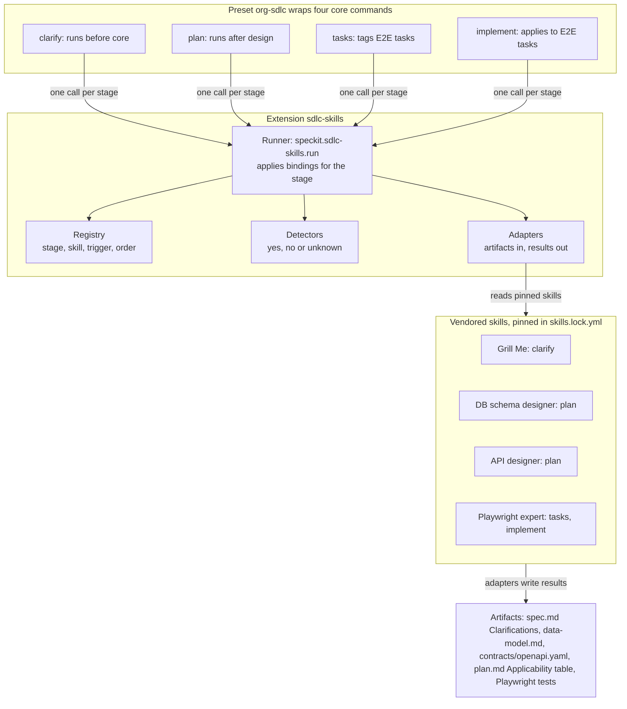

# Spec Kit Extension Spec: Skill-Driven Clarify, Plan and Test Phases

> **Implementation note.** In this repository the extension ships as `engineering-build` (`speckit-extensions/engineering-build/`) and the preset as `engineering-build-preset` (its `preset/` folder). Commands are `speckit.engineering-build.<name>`, the registry is `engineering-build-config.yml`, and skills live in the top-level `skills/` folder, copied in by the installer. Names below are the original design names.

Oct 28, 2026

## 1. Overview and goals

This spec defines one Spec Kit preset and one extension that make four existing agent skills run at the right SDLC phase, plus a binding model that lets unit-test, e2e and other stages be added later by editing config, not code.

**Problem.** Spec Kit's `clarify`, `plan`, `tasks` and `implement` commands are generic, so output quality depends on the model's defaults. The team wants vetted skills applied consistently, and the same setup reused across the organization.

**Goals**

- G1: Run the Grill Me interview during clarify so edge cases are surfaced before planning.
- G2: During plan, run the database schema designer only when the feature changes the data model.
- G3: During plan, run the API designer only when the feature adds or changes an API.
- G4: Apply the Playwright expert skill whenever Playwright tests are created.
- G5: Make adding a new stage-to-skill pairing (unit testing, e2e, security review) a config change.
- G6: Package everything so any repo can adopt it with `specify preset add` and `specify extension add`.

**Non-goals**

- Changing Spec Kit core or forking it.
- Rewriting or modifying the four skills; they are consumed as published and pinned.
- Applying migrations to a real database or deploying an API.
- Replacing human review of `spec.md` and `plan.md`.

**Scope at a glance**

| Spec Kit step | Skill | Source | Runs when |
| --- | --- | --- | --- |
| `clarify` | grill-me | [mattpocock/skills](https://github.com/mattpocock/skills/blob/main/docs/productivity/grill-me.md) | Always |
| `plan` | database-schema-designer | [OneWave-AI/claude-skills](https://github.com/OneWave-AI/claude-skills/blob/main/database-schema-designer/SKILL.md) | Feature changes the data model |
| `plan` | api-designer | [Jeffallan/claude-skills](https://github.com/Jeffallan/claude-skills/blob/main/skills/api-designer/SKILL.md) | Feature adds or changes an API |
| `tasks` and `implement` | playwright-expert | [Jeffallan/claude-skills](https://github.com/Jeffallan/claude-skills/blob/main/skills/playwright-expert/SKILL.md) | A Playwright test is generated or written |

## 2. Background and findings that shape the design

Spec Kit offers two extension points, and each has a limit that decides where our pieces must live. Facts below come from the [extensions reference](https://github.github.com/spec-kit/reference/extensions.html), the [presets reference](https://github.github.com/spec-kit/reference/presets.html) and the extension development guide on [GitHub](https://github.com/github/spec-kit/blob/main/extensions/EXTENSION-DEVELOPMENT-GUIDE.md).

| Mechanism | What it can do | Limit that matters here |
| --- | --- | --- |
| Extension | Adds new commands (`speckit.<ext>.<cmd>`), config files, and hooks declared in `extension.yml` | Hooks only fire `before_<command>` or `after_<command>`, never mid-command |
| Preset | Overrides or wraps core templates, commands and scripts with `replace`, `prepend`, `append` or `wrap` | Cannot add new commands or config of its own, but can declare `requires.extensions` |
| Project override | `.specify/templates/overrides/` wins over everything | Per-repo only; not shareable |

Resolution order is project override, then presets by priority, then extensions by priority, then core. A lower priority number wins, and the default is 10.

**Findings**

1. Mid-command injection needs a preset. Conditional DB and API design must happen inside `plan`, once draft design artifacts exist. Hooks cannot do that, so a preset wraps the `plan` command.
2. Hook `condition` fields are not reliable yet. The docs say command templates do not evaluate them and skip any hook that has one. Conditional logic must live in our own runner, not in hook conditions.
3. Hook events exist for `clarify`, `plan`, `tasks` and `implement`, each with a `before_` and `after_` form. Optional hooks prompt the user; non-optional hooks run automatically.
4. Extension config merges in four layers: `extension.yml` defaults, project config, local overrides, then `SPECKIT_<EXT>_*` environment variables. Our bindings registry should ride this mechanism.
5. There is no dedicated test-creation step in Spec Kit. Playwright tests appear as tasks from `tasks` and as code from `implement`, so those two commands are the attachment points.

**The four skills**

| Skill | What it does | Constraint to respect |
| --- | --- | --- |
| grill-me | Interviews the user in rounds, each covering every question whose prerequisites are answered, until no unvisited branch remains. Stateless; writes no files | Meant for a fresh conversation with plan mode off; the user must own scope. Vendored from this [docs article](https://github.com/mattpocock/skills/blob/main/docs/productivity/grill-me.md), confirmed as the skill's source |
| database-schema-designer | Produces DDL, ERD, index rationale and reversible migrations; defaults to PostgreSQL; derives indexes from the 5-10 key queries | Needs engine, entities, key queries, volume and tenancy; has a pre-delivery checklist |
| api-designer | Produces resource model, OpenAPI 3.1 YAML, RFC 7807 error catalog, pagination and versioning plan | Expects a passing `npx @redocly/cli lint` and a Prism mock check |
| playwright-expert | Page Object Model tests, role-based locators, auto-waiting, traces, parallel runs, CI integration | Forbids `waitForTimeout()`, CSS-class selectors and shared state between tests |

## 3. Requirements

The system must satisfy 12 functional and 6 non-functional requirements, plus the 14 installer requirements (IR-1 to IR-14) in section 10; IDs are used in section 12 for traceability.

**Functional**

| ID | Requirement |
| --- | --- |
| FR-1 | Ship as one preset (`org-sdlc`) and one extension (`sdlc-skills`); the preset declares `requires.extensions` on the extension |
| FR-2 | Define stage-to-skill pairings as bindings in `sdlc-skills-config.yml`, each with stage, skill, trigger, mode, outputs and `enabled` |
| FR-3 | In `speckit.clarify`, run the grill-me interview and record every question and answer in `spec.md` under Clarifications |
| FR-4 | In `speckit.plan`, decide whether the feature changes the data model; if yes, run database-schema-designer and fold its output into `data-model.md` |
| FR-5 | In `speckit.plan`, decide whether the feature adds or changes an API; if yes, run api-designer and write the OpenAPI 3.1 file under `contracts/` |
| FR-6 | Record each applicability decision, with evidence, in a Skill Applicability table in `plan.md`, including decisions to skip |
| FR-7 | In `speckit.tasks`, emit tasks tagged `[E2E]` for Playwright work; in `speckit.implement`, apply playwright-expert to every `[E2E]` task |
| FR-8 | Load skills from vendored, version-pinned copies inside the extension; never fetch a skill at run time |
| FR-9 | If a skill's tooling is missing (for example `npx` or network for Redocly lint), record a warning and continue, unless the binding sets `required: true` |
| FR-10 | Let a repo disable any binding or override its trigger through project or local config |
| FR-11 | Adding a new stage-to-skill pairing must need only a vendored skill, an adapter file and a config entry |
| FR-12 | Work on any agent Spec Kit supports by reading skills as instruction files, not through a Claude-only skill invocation |

**Non-functional**

| ID | Requirement |
| --- | --- |
| NFR-1 | Auditable: every skill run or skip is traceable to a recorded decision and a pinned skill version |
| NFR-2 | Idempotent: re-running `plan` or `clarify` updates existing sections instead of duplicating them |
| NFR-3 | Compatible: declare a minimum Spec Kit version in `requires.speckit_version` and test against it |
| NFR-4 | Safe supply chain: each vendored skill carries its source URL, commit SHA and SHA-256 in a lockfile |
| NFR-5 | Non-blocking by default: a failed skill degrades the output with a warning rather than stopping the phase |
| NFR-6 | Licensed: each vendored skill's license permits redistribution inside the organization (all four are MIT; each copy keeps its license notice) |

## 4. Architecture

The logic lives in one extension and a preset thin-wraps four core commands to call it. Spec Kit's limits force the split: only a preset can place a step inside a core command, and only an extension can ship new commands, config and hooks.



Each wrapped command makes one call to the runner with its stage name. The runner loads the matching bindings, evaluates their triggers with detectors, and for each match reads the adapter and the pinned skill, then writes results into the feature's artifacts. Core Spec Kit and the four skills stay unmodified.

**Where each wrap sits**

| Command | Wrap position | Reason |
| --- | --- | --- |
| `clarify` | Before core steps | Answers from the grill pass shrink core clarify's gap scan |
| `plan` | After core design step | Drafts of `data-model.md` and `contracts/` exist to be reviewed and revised; hooks cannot place a step mid-command |
| `tasks` | After core task generation | Adds or retags `[E2E]` tasks with scenario IDs |
| `implement` | Before core steps, as a standing instruction | When a task matches a binding, load the skill before writing the code |

**Design principles**

- Wrapped commands hold one runner call and no skill logic.
- Every skill-specific rule lives in an adapter, a detector or the registry.
- Every run and skip is written down, so a reviewer can see what was applied and why.

## 5. Capability 1: Grill Me in clarify

The preset wraps `speckit.clarify` so a grill-me interview runs first, and core clarify then consolidates the answers into `spec.md`. Covers FR-3 and FR-10.

**Attachment.** The preset ships `commands/speckit.clarify.md` with the `wrap` strategy. Its body runs the stage bindings for `clarify`, then `{CORE_TEMPLATE}`. Running grill first means core clarify's ambiguity scan sees the answers and only asks about what is still open.

**Behavior of the grill pass**

1. Load `spec.md` and the project constitution as the starting idea; do not ask about anything they already answer.
2. Ask in rounds. Each round covers the whole frontier: every question whose prerequisites are already answered. A config switch (`interaction: one-at-a-time`) changes this for teams that prefer single questions.
3. Apply the edge-case lenses listed below as extra branches, so each lens is either answered or explicitly marked not applicable.
4. Let the user answer "I don't know". Record those as open assumptions, never as silent defaults.
5. When a question needs something to react to (layout, feel), stop grilling it and record it as Deferred: needs prototype.
6. Stop when the frontier is empty, the user says stop, or `max_rounds` is reached.
7. If the question count passes `split_threshold`, advise splitting the feature into smaller specs and grilling each.

**Edge-case lenses** (additive to grill-me, configurable): empty and null input, boundary values, permissions and roles, concurrency and ordering, partial failure and retries, idempotency, timeouts, data volume, backfill and migration, rollback, observability, accessibility, localization.

**Output.** Each question and answer goes under `## Clarifications` in `spec.md` as `### Session <date>`, and the affected spec sections (requirements, edge cases, assumptions) are updated in place. Re-running clarify appends a new session and edits, never duplicates (NFR-2).

**Optional gate.** An `after_clarify` hook runs `speckit.sdlc-skills.edge-case-audit`, a short check that every lens has an answer or an explicit N/A. It is `optional: true` by default.

| Config key | Default | Meaning |
| --- | --- | --- |
| `interaction` | `rounds` | `rounds` or `one-at-a-time` |
| `max_rounds` | 6 | Hard stop for the interview |
| `split_threshold` | 40 | Question count that triggers the advice to split scope |
| `edge_case_lenses` | list above | Add, remove or reword lenses per repo |

**Known mismatches to handle.** Grill-me is designed for a fresh conversation with plan mode off and writes no files; clarify runs inside an existing session and must write to `spec.md`. The adapter therefore tells the user to run clarify outside plan mode and performs all file writes itself, after the interview.

## 6. Capability 2: database design in plan

During `speckit.plan`, a detection step decides whether the feature changes the data model; only a yes runs database-schema-designer. Covers FR-4, FR-6 and FR-9.

**Detection.** The runner scans `spec.md` and the plan's Technical Context and sets `db_change` to `yes`, `no` or `unknown`, with quoted evidence. Signals for yes: new or changed entities in Key Entities, persistent state, new fields or relationships, retention or audit needs, search or reporting over stored data, or an existing migrations folder that the feature touches. `unknown` triggers one question to the user rather than a silent skip.

**Inputs, derived before asking.** The skill wants these; the adapter fills them from existing artifacts and asks only for gaps.

| Skill input | Derived from |
| --- | --- |
| Database engine and version | Plan Technical Context (Storage), then repo files; the constitution wins over the skill's PostgreSQL default |
| Entities and relationships | Key Entities and requirements in `spec.md` |
| 5-10 key queries | User stories and functional requirements, written out with filters and sort order |
| Volume, growth, read/write mix | Non-functional requirements, else asked |
| Tenancy, retention, audit, PII | Constitution and `spec.md`, else asked |
| ORM or migration tool | Detected from the repo (for example Alembic, Flyway, Prisma, EF Core) |

**Outputs and where they land.**

- `data-model.md` (the core plan artifact) gets entities, an ERD, constraints, and an index table mapping each index to the query it serves.
- Draft DDL and reversible migrations go to `specs/<feature>/db/`, not into the application tree; `tasks` later turns them into implementation tasks.
- The skill's pre-delivery checklist is copied into `plan.md` as a quality gate, each item marked pass, fail or not applicable. Examples: every foreign key has an `ON DELETE` rule and an index, timestamps are timezone-aware, and destructive rollbacks are flagged.

**Verification.** If a database is reachable, run the DDL and `EXPLAIN` the key queries; otherwise walk each query against the schema by hand and say so in `plan.md`. A failed or skipped check is a warning, not a stop, unless `required: true` (FR-9).

**Ordering.** The DB step runs before the API step, so API resources are modeled on the agreed data model.

## 7. Capability 3: API design in plan

After the database step, the runner decides whether the feature adds or changes an API; only a yes runs api-designer. Covers FR-5, FR-6 and FR-9.

**Detection.** The runner sets `api_change` to `yes`, `no` or `unknown`, with evidence. Signals for yes: user stories that name a client calling a service, new or changed endpoints, webhooks or public integrations, a UI that needs new server data, or an existing OpenAPI file in the repo that the feature touches. The skill covers REST and GraphQL; for gRPC or event contracts the adapter records `unsupported style` and skips with a warning.

**Inputs.** Domain requirements from `spec.md`, the data model from `data-model.md` (so resources follow the agreed entities), the auth approach from the constitution or plan, and any existing OpenAPI file.

**Outputs and where they land.** The skill's output format maps onto Spec Kit's plan artifacts as follows.

| Skill deliverable | Lands in |
| --- | --- |
| Resource model and relationships | `plan.md`, API Design section |
| Endpoint specifications | `contracts/` summary table |
| OpenAPI 3.1 YAML | `contracts/openapi.yaml` (edited in place when one exists) |
| Auth and authorization flows | `plan.md`, API Design section |
| Error catalog (RFC 7807 `type` URIs), pagination and filtering, versioning and deprecation | `contracts/openapi.yaml` plus a short summary in `plan.md` |
| Lint result from `npx @redocly/cli lint` | `plan.md` quality gate |

**Verification.** Run the Redocly lint and a Prism mock check when `npx` and network are available. Otherwise record the check as skipped, with the reason, as a warning (FR-9). Set `required: true` in config to make a failing lint block the plan.

**Breaking changes.** When an OpenAPI file already exists, the adapter requires an explicit Breaking changes note in `plan.md` listing each change and its migration path. This enforces the skill's rule against breaking changes without one.

**Hand-off to tasks.** The plan lists the contract file as the source of truth, so `speckit.tasks` can generate contract-test and mock-server tasks from it.

## 8. Capability 4: Playwright expert for test creation

Spec Kit has no test-creation step, so the skill attaches in two places: `tasks` decides which tests to write, and `implement` writes them. Covers FR-7 and FR-9.

**In `speckit.tasks` (preset wrap).** The skill's first step, identify user flows to test, runs against the acceptance scenarios in `spec.md`. The command then emits one task per flow, tagged `[E2E]`, with the scenario ID in the task text (for example `US1-AS2`). If the repo has no Playwright config, a setup task comes first.

**In `speckit.implement` (preset wrap).** For every `[E2E]` task, and for any task whose target path matches the configured globs (default `e2e/**/*.spec.ts`, `tests/e2e/**/*.spec.ts`), the runner loads the skill and applies its workflow: configure, write with Page Objects, debug, wire into CI.

**Rules enforced after writing.** The skill's must-do and must-not-do lists become checks run on the new files.

| Rule from the skill | Check |
| --- | --- |
| No `waitForTimeout()` | Pattern search fails the task if found |
| No CSS-class selectors | Pattern search flags class-based locators |
| `first()` and `nth()` only with a reason | Flag any use that lacks an adjacent comment |
| Role-based selectors preferred | Reported as a ratio, warning only |
| Independent tests, no shared state | Run with `--repeat-each=2` and in random order when supported |
| Traces and screenshots on failure | Verified in `playwright.config.ts` |
| Parallel execution | Verified in `playwright.config.ts` |

**Traceability.** Each test title includes its scenario ID so coverage of `spec.md` can be audited (NFR-1).

**Deliverables per the skill:** Page Object classes, test files with assertions, fixtures when needed, and configuration recommendations. The task is done only when the new tests run green once locally or the failure is recorded as a warning (FR-9).

**Interaction with the API step.** If `contracts/openapi.yaml` exists, the adapter may use its examples as route-mock payloads, following the skill's API-mocking reference.

## 9. Extensibility: the stage-to-skill binding model

Nothing in sections 5 to 8 is hard-coded into the wrapped commands. Each wrapped command contains one line that calls a runner, `speckit.sdlc-skills.run <stage>`, and the runner reads a registry of bindings. Unit testing, e2e, security review or any later stage is a new binding, not a new command template. Covers FR-2 and FR-11.

**Three concepts**

- **Stage**: a named point in the workflow. Core stages are `clarify`, `plan`, `tasks`, `implement`, `analyze` and `checklist`. Sub-stages use a dot, such as `implement.unit-test` or `implement.e2e-test`.
- **Skill**: a vendored, pinned `SKILL.md` with its reference files, recorded in `skills.lock.yml`.
- **Adapter**: a short Markdown file per skill that translates between Spec Kit artifacts and the skill's inputs and outputs, and says where results are written. Skills stay unmodified; all project glue lives here.

**Registry** (`sdlc-skills-config.yml`). This is the shipped default; repos override it through the extension's normal config layers.

```yaml
schema_version: "1.0"
defaults:
  required: false        # false = warn and continue; true = block the stage
bindings:
  - id: clarify-grill
    stage: clarify
    skill: grill-me
    trigger: { type: always }
    settings: { interaction: rounds, max_rounds: 6, split_threshold: 40 }
  - id: plan-db
    stage: plan
    order: 10
    skill: database-schema-designer
    trigger: { type: detect, detector: db_change, ask_if_unknown: true }
  - id: plan-api
    stage: plan
    order: 20
    skill: api-designer
    depends_on: [plan-db]
    trigger: { type: detect, detector: api_change, ask_if_unknown: true }
  - id: tasks-e2e
    stage: tasks
    skill: playwright-expert
    trigger: { type: detect, detector: ui_flows }
  - id: impl-e2e
    stage: implement.e2e-test
    skill: playwright-expert
    trigger:
      type: any
      of:
        - { type: task_tag, tag: E2E }
        - { type: path_glob, globs: ["e2e/**/*.spec.ts"] }
  # Example of a future binding; not shipped in v1
  # - id: impl-unit
  #   stage: implement.unit-test
  #   skill: <unit-test-skill>
  #   trigger: { type: task_tag, tag: UT }
```

**Trigger types**

| Type | Fires when | Used by |
| --- | --- | --- |
| `always` | The stage runs | grill-me |
| `detect` | A named detector returns yes; `unknown` asks the user once | DB, API, UI flows |
| `task_tag` | A task carries the tag, for example `[E2E]` | Playwright, future unit tests |
| `path_glob` | A task writes to a matching path | Playwright, future unit tests |
| `any` / `all` | Any or all of the nested triggers match | Combined rules |

A detector is a named prompt with a fixed output shape (`yes`, `no` or `unknown`, plus evidence) stored in `detectors/<name>.md`. Adding a detector never touches command templates.

**Adding a new stage-to-skill pairing**

1. Vendor the skill into `skills/<id>/` and add its entry to `skills.lock.yml` (source URL, commit SHA, SHA-256, license).
2. Write `adapters/<id>.md`: inputs from Spec Kit artifacts, output locations, quality gate.
3. If the trigger needs judgment, add `detectors/<name>.md`.
4. Add a binding to the registry.
5. Run `specify extension update sdlc-skills` and the conformance tests from section 12.

If the new stage is not one of the core commands (for example, a post-implement security review), step 4 also adds an extension hook such as `after_implement` that calls the runner for that stage. The core commands that need a mid-command step stay wrapped by the preset.

## 10. Repository layout and manifests

One repository holds both packages, so they version and release together. The manifest sketches follow the field names in the Spec Kit docs; the preset schema is only partly documented, so confirm its fields against the installed version before building (open question Q3).

```text
spec-kit-org-sdlc/
├── extension/                      # id: sdlc-skills
│   ├── extension.yml
│   ├── commands/
│   │   ├── speckit.sdlc-skills.run.md
│   │   └── speckit.sdlc-skills.edge-case-audit.md
│   ├── config/sdlc-skills-config.template.yml
│   ├── adapters/                   # grill-me, database-schema-designer, api-designer, playwright-expert
│   ├── detectors/                  # db_change, api_change, ui_flows
│   ├── skills/<skill-id>/          # vendored SKILL.md + references/
│   ├── skills.lock.yml
│   └── scripts/                    # verify-lock, check-playwright-rules
├── preset/                         # id: org-sdlc
│   ├── preset.yml
│   └── commands/                   # speckit.clarify, plan, tasks, implement
├── tests/                          # conformance and fixture repos
└── catalog/                        # entries for an internal catalog
```

**`extension.yml` (illustrative)**

```yaml
schema_version: "1.0"
extension:
  id: "sdlc-skills"
  name: "SDLC Skill Bindings"
  version: "1.0.0"
  description: "Runs pinned skills at Spec Kit stages via a binding registry"
  license: "MIT"
requires:
  speckit_version: ">=0.8.0"     # set to the tested minimum
provides:
  commands:
    - name: "speckit.sdlc-skills.run"
      file: "commands/speckit.sdlc-skills.run.md"
      description: "Apply the bindings for a stage"
    - name: "speckit.sdlc-skills.edge-case-audit"
      file: "commands/speckit.sdlc-skills.edge-case-audit.md"
      description: "Check every edge-case lens is answered or N/A"
  config:
    - name: "sdlc-skills-config.yml"
      template: "config/sdlc-skills-config.template.yml"
      description: "Binding registry and settings"
      required: true
hooks:
  after_clarify:
    command: "speckit.sdlc-skills.edge-case-audit"
    optional: true
    prompt: "Audit edge-case coverage?"
    description: "Edge-case coverage check"
```

**`preset.yml` (illustrative)**

```yaml
preset:
  id: "org-sdlc"
  name: "Organization SDLC Standards"
  version: "1.0.0"
requires:
  extensions:
    - id: "sdlc-skills"
      required: true
provides:
  commands:
    - { name: "speckit.clarify",   file: "commands/speckit.clarify.md",   strategy: wrap }
    - { name: "speckit.plan",      file: "commands/speckit.plan.md",      strategy: wrap }
    - { name: "speckit.tasks",     file: "commands/speckit.tasks.md",     strategy: wrap }
    - { name: "speckit.implement", file: "commands/speckit.implement.md", strategy: wrap }
```

**A wrapped command** is deliberately tiny, so logic stays in the registry:

```markdown
## Skill bindings (before core steps)
Run /speckit.sdlc-skills.run clarify, then continue.

{CORE_TEMPLATE}
```

This is the `clarify` form. The `plan` and `tasks` wraps put `{CORE_TEMPLATE}` first and the runner call after it; `implement` carries the runner call as a standing instruction, as set out in section 4.

**Install and priority.** `specify extension add sdlc-skills`, then `specify preset add org-sdlc --priority 5`. A lower number wins, so a repo that needs to override a wrapped command can add its own preset at a lower number or use `.specify/templates/overrides/`.

### Installing into a repo with Python scripts

A Python installer in `installer/` at the repo root adds the extension and preset to any Spec Kit project, one repo or many. It drives the `specify` CLI rather than copying files itself, so Spec Kit stays the owner of its own registries. Covers FR-1 and FR-12.

| ID | Requirement |
| --- | --- |
| IR-1 | One entry point, `python installer/install.py <command>`, with commands `install`, `update`, `verify`, `status` and `uninstall` |
| IR-2 | Preflight before any change: the target has a `.specify/` folder from `specify init`, `specify` is on the PATH at or above the minimum version, the Python version meets the minimum, and the git tree state is reported (a dirty tree warns, it does not stop) |
| IR-3 | Install the extension first, then the preset, because the preset requires the extension: `specify extension add sdlc-skills`, then `specify preset add org-sdlc --priority <N>` (default 5, configurable) |
| IR-4 | Sources are selectable with `--source catalog`, `--source url` or `--source local`, and `--version` pins an exact release |
| IR-5 | Idempotent: running `install` again at the same version changes nothing and reports `already installed` |
| IR-6 | Config bootstrap: copy `sdlc-skills-config.template.yml` to `sdlc-skills-config.yml` only if it does not exist; never overwrite project config; support `--profile default` and `--profile strict` (sets `required: true` on the quality gates) and `--set key=value` overrides |
| IR-7 | Integrity: verify the archive SHA-256 for URL and catalog sources, and run `verify-lock` on the vendored skills before and after installing; abort on any mismatch |
| IR-8 | `--dry-run` prints every command and file change it would make and makes none |
| IR-9 | Backup and rollback: copy `.specify/extensions.yml` and the preset registry to `.specify/.backup/<timestamp>/` first, and restore them if any step fails. This matters because `preset update` removes then re-adds with no rollback of its own |
| IR-10 | Post-install checks: `specify extension list --json` shows the extension enabled, `specify preset list --json` shows the preset, and `specify preset resolve` returns the preset for each of `speckit.clarify`, `speckit.plan`, `speckit.tasks` and `speckit.implement` |
| IR-11 | Bulk mode: `--repos-file repos.txt` installs across many repos, continues past failures, and prints one result row per repo |
| IR-12 | `verify` mode is CI-safe: exits non-zero if the version is below the required minimum, a `locked` binding is disabled, or a vendored skill's hash has drifted |
| IR-13 | Standard library only, no `pip install` needed; runs on Linux, macOS and Windows using `pathlib` and `subprocess` without a shell; supports an offline bundle (a zip with the extension, preset and lockfile) |
| IR-14 | Machine-readable `--json` output, stable exit codes (0 success, 1 failure, 2 preflight failure, 3 integrity failure), a log at `.specify/sdlc-skills-install.log`, and a final reminder to restart the AI agent if the new commands do not appear |

**Usage**

```bash
# one repo, from the internal catalog, pinned
python installer/install.py install --repo ~/code/payments-api --source catalog --version 1.0.0 --profile default

# preview a rollout to many repos from a local checkout
python installer/install.py install --repos-file repos.txt --source local --dry-run

# CI gate
python installer/install.py verify --repo . --json
```

**Install flow**

1. Preflight (IR-2); stop with exit code 2 on failure.
2. Back up the Spec Kit registries (IR-9).
3. Verify the source archive and the lockfile (IR-7).
4. Run `specify extension add`, then `specify preset add` (IR-3).
5. Bootstrap config (IR-6).
6. Run the post-install checks (IR-10); roll back on failure.
7. Print the summary and the restart reminder (IR-14).

**Open point (Q8).** The exact flags for installing from a local directory (`--dev` and `--from`) are taken from the Spec Kit docs and differ slightly between the extension and preset commands; confirm them against the installed version before building the installer.

## 11. Versioning, security and governance

Skills are instructions the agent obeys, so they are treated like code that runs with the developer's permissions. Covers FR-8, NFR-4 and NFR-6.

**Versioning**

- The extension and preset follow SemVer and release together from one repo; each release carries a `download_url` and `sha256` in the internal catalog, as Spec Kit catalogs require.
- Each vendored skill is pinned by upstream commit SHA in `skills.lock.yml` with a SHA-256 of its files, its license and its source URL.
- A skill upgrade is a pull request that shows the upstream diff, reruns the conformance tests (section 12) and bumps the extension's minor version.
- Tool versions the skills call, such as `@redocly/cli` and Playwright, are pinned in the adapters so results are reproducible.

**Supply chain and prompt-injection risk**

- Skills are copied in, reviewed once, and never fetched at run time (FR-8).
- `scripts/verify-lock` recomputes hashes on install and in CI, and fails on drift.
- The internal catalog is the only one with `install_allowed: true`. Spec Kit's community catalog stays discovery-only, as its docs advise.
- Adapters and detectors are reviewed like code. A skill that gains new tool permissions or network instructions on upgrade is flagged in the review.

**Governance for an organization-wide standard**

- CODEOWNERS on the repo names the owners of the registry, adapters and lockfile.
- A binding may be marked `locked: true`. Repos can tune its settings but a CI check (`verify`) fails if a locked binding is disabled or its skill is swapped.
- Per-repo changes go through the extension's config layers (project config, local overrides, environment variables), so they are visible in version control.
- The extension writes no telemetry; the Skill Applicability table in `plan.md` is the audit trail (NFR-1).

**Licensing.** All four skills are MIT licensed, as confirmed by the project owner (api-designer also declares it in its frontmatter). MIT permits vendoring, provided each copy keeps its license text and copyright notice, which \`skills.lock.yml\` records.

## 12. Acceptance criteria and test plan

The work is accepted when all 17 scenarios below pass on fixture repos. Because model output varies, tests assert on structure and artifacts (files, sections, table rows, exit codes), never on exact wording.

| ID | Scenario | Covers |
| --- | --- | --- |
| AC-1 | Given a spec with vague requirements, when `clarify` runs, then grill rounds occur and `spec.md` gains a `Clarifications` session with the Q&A | FR-3 |
| AC-2 | Given AC-1 completed, when `clarify` runs again, then a new session is appended and no existing section is duplicated | NFR-2 |
| AC-3 | Given a feature with a new entity and no endpoint, when `plan` runs, then `data-model.md` is updated, no OpenAPI file is created, and the Skill Applicability table shows DB yes and API no with evidence | FR-4, FR-6 |
| AC-4 | Given a feature with a new endpoint and no new entity, when `plan` runs, then `contracts/openapi.yaml` exists and DB is recorded as skipped | FR-5, FR-6 |
| AC-5 | Given a feature with neither, when `plan` runs, then both skills are skipped and each skip is recorded | FR-6 |
| AC-6 | Given an ambiguous feature, when detection returns `unknown`, then exactly one question is asked and the answer is recorded | FR-4, FR-5 |
| AC-7 | Given no network, when the API step runs, then a lint-skipped warning is recorded and `plan` completes; with `required: true` it stops | FR-9, NFR-5 |
| AC-8 | Given acceptance scenarios in `spec.md`, when `tasks` runs, then each UI flow has an `[E2E]` task naming its scenario ID | FR-7 |
| AC-9 | Given an `[E2E]` task, when the written test contains `waitForTimeout`, then the post-write check fails the task | FR-7 |
| AC-10 | Given a tampered vendored skill, when `verify-lock` runs, then it exits non-zero | FR-8, NFR-4 |
| AC-11 | Given local config disabling a binding, then it is skipped; disabling a `locked` binding fails CI `verify` | FR-10 |
| AC-12 | Given only a new config binding plus a stub skill and adapter for `implement.unit-test`, when a `[UT]` task runs, then the stub skill is applied with no command-template edits | FR-11 |
| AC-13 | Given the same fixture, when run on a second supported agent, then the same artifacts and sections are produced | FR-12 |
| AC-14 | Given a clean repo with `specify init`, when `extension add` and `preset add` run, then all four wrapped commands resolve to the preset versions (`specify preset resolve`) | FR-1 |
| AC-15 | Given a clean Spec Kit repo, when the installer's install command runs, then the extension and preset are installed in order and all four commands resolve to the preset; a second run reports already installed | IR-3, IR-5, IR-10 |
| AC-16 | Given a failure injected after the extension is added, when the installer runs, then the registries are restored from the backup and the exit code is non-zero; with --dry-run no file changes at all | IR-8, IR-9 |
| AC-17 | Given a repos file with three repos, one of them not initialized, when bulk install runs, then two succeed, one fails preflight with exit code 2 in the report, and existing project config is never overwritten | IR-2, IR-6, IR-11 |

**Test levels**

- **Static**: validate manifests, registry schema, adapter and detector file presence, and lockfile hashes in CI.
- **Detector goldens**: a set of fixture specs with expected `yes`, `no` or `unknown` results for each detector, run on every change to a detector or skill.
- **Scripted end-to-end**: fixture repos driven through `clarify`, `plan`, `tasks` and `implement`, with assertions on generated artifacts.
- **Upgrade gate**: any skill or Spec Kit version bump reruns all levels before release.

## 13. Rollout, risks and open questions

Roll out in five phases, starting with a spike that settles the two Spec Kit unknowns (Q3 and Q4) before any build work.

**Rollout**

1. Spike: in a sandbox repo, confirm that a preset can `wrap` all four commands and where the skill pass can sit inside `plan`.
2. Build the runner, registry, lockfile tooling and the clarify binding; ship AC-1, AC-2, AC-10, AC-14.
3. Add the DB and API detectors and bindings with golden fixtures; ship AC-3 to AC-7.
4. Add the Playwright bindings and rule checks; ship AC-8, AC-9, then AC-11 to AC-13.
5. Pilot on one or two repos, then publish to the internal catalog and document adoption.

**Risks**

| Risk | Mitigation |
| --- | --- |
| A `wrap` can only add text before or after core `plan`, not between its phases | Run the skill pass after the core design step as a review-and-revise of the draft artifacts; fall back to a pinned `replace` of `plan` only if that proves insufficient |
| Hook `condition` is not evaluated by command templates today | Keep all conditional logic in the runner's detectors (section 9) |
| Core command text changes in a Spec Kit release and breaks a wrap | Declare `requires.speckit_version`, and run the upgrade gate before adopting a new version |
| Detectors misjudge applicability | `unknown` asks the user; golden fixtures catch regressions; the Applicability table makes mistakes visible |
| Long grill sessions tire users | `max_rounds`, `split_threshold` and the option to answer "I don't know" |
| An upstream skill changes behavior | Vendored copies pinned by SHA; upgrades go through review and tests |
| Tooling such as `npx` or the network is missing | Fail-soft warnings by default (FR-9) |

**Open questions**

- Q1: Resolved: the grill-me docs page is the source to vendor. Still open: use the plain interview or the `grill-with-docs` variant that reads the codebase and records decisions?
- Q2: Resolved: all four skills are MIT licensed, so they can be redistributed inside the organization with their license notices kept.
- Q3: What are the full `preset.yml` fields, and how is the `wrap` strategy declared per command? The public docs describe the behavior but not the schema.
- Q4: Where in the installed `speckit.plan` command can an extra step go? This decides between a post-design review pass and a `replace`.
- Q5: Which AI agents must be supported, and which Spec Kit version is the minimum?
- Q6: Should failed quality gates warn (default here) or block for specific bindings such as the API lint?
- Q7: Should the e2e binding also cover other browser-test stacks, or is Playwright the only target?
