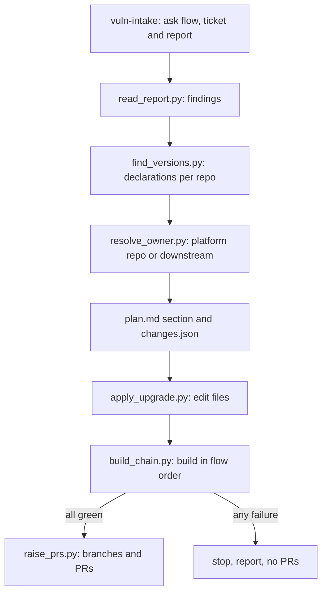

# Spec Kit Extension Spec Addendum: Engineering Vulnerability Upgrade from a Vulnerability Report

> **Implementation note.** In this repository the extension ships as `engineering-build` (`speckit-extensions/engineering-build/`) and the preset as `engineering-build-preset` (its `preset/` folder). Commands are `speckit.engineering-build.<name>`, the registry is `engineering-build-config.yml`, and skills live in the top-level `skills/` folder, copied in by the installer `speckit-extensions/install.py`. The catalog entry is `speckit-extensions/catalog.json`. Names and paths below (`sdlc-skills`, `org-sdlc`, `installer/`, `catalog/`) are the original design names.

Addendum to *Skill-Driven Clarify, Plan and Test Phases* (the parent spec, `spec-kit-extension-spec.md`). It adds one more stage-to-skill pairing to the `sdlc-skills` extension using the binding model in the parent's section 9, plus a set of Python scripts that do the deterministic work: reading the vulnerability report, finding versions across repos, building in order, and raising pull requests.

**Implementation status.** Built into the `engineering-build` extension (`speckit-extensions/engineering-build/`: `scripts/vuln/`, the `vuln-intake` and `vuln-pr` commands, `config/vuln-flows.json`, tests) with its skill in `skills/engineering-vulnerability-upgrade/`. Where this spec and the code differ, the code wins: the flow config is `config/vuln-flows.json` (standard library only, no YAML), the branch is asked first and created from a parent branch when missing (`prepare_branches.py`), both flows publish to Maven Local, each repo's published version is handed to the later repos through their `gradle/dependencies.conf` (GV-20), and operating-system packages in the report are listed as out of scope. Section numbers below refer to the parent spec. IDs are prefixed `GV-`.

## 1. Overview and goals

**Problem.** Vulnerability reports (scanner exports, or tickets in any tracker) list vulnerable dependency versions and their fixed versions. Fixing one means finding where each version is declared across many Gradle repos (`dependencies.conf`, `build.gradle`, property files), deciding whether the fix belongs in the platform repo or in a downstream repo that overrides it, building the whole chain in order, and raising PRs. Today this is manual and easy to get wrong.

**Goals**

- G1: Take a build flow (named in the flow config) a ticket ID in any tracker and a vulnerability report, and read the vulnerable and fixed versions from the report.
- G2: Find every place each vulnerable version is declared and change it in the right repo (platform if it lives only there, otherwise the downstream repo that holds or overrides it).
- G3: Build the full repo chain for the chosen flow in dependency order, publishing where the next step needs the result.
- G4: Raise PRs only when every build passes.
- G5: Record what was found, changed and built, so a reviewer can audit it.

**Non-goals**

- Choosing fixed versions. They come from the report; the tool never invents or "improves" a version.
- Fixing vulnerabilities in application code, or non-Gradle ecosystems.
- Merging PRs, releasing, or deploying.
- Replacing human review of the PRs.

**Scope at a glance**

| Spec Kit step | What runs | Runs when |
| --- | --- | --- |
| Entry command | `speckit.sdlc-skills.vuln-intake`: asks flow, ticket and report, reads the report, seeds `spec.md` | User starts a vulnerability fix |
| `plan` | `engineering-vulnerability-upgrade` locate pass: finds declarations and the owning repo per dependency | Detector `vuln_report` returns yes |
| `tasks` | Emits one `[VULN]` task per repo in flow order | Plan has a Vulnerability Upgrade section |
| `implement.vuln-upgrade` | Applies edits, builds and publishes in order | `[VULN]` task |
| `after_implement` hook | `speckit.sdlc-skills.vuln-pr`: raises PRs if all builds are green | Always for this flow |

## 2. Findings that shape the design

1. The steps are mostly deterministic (report parsing, file search, ordered builds, git, PRs). They belong in scripts, not in model judgment. The model's job is limited to interpreting free-text report content and resolving ambiguous override cases; every script writes JSON so the model's step is checkable.
2. Questions to the user (flow, ticket ID, report) cannot be asked by a script that runs unattended, so a command asks and passes the answers to scripts as arguments.
3. The two flows have different repo chains and different publish needs, so each flow is a config entry (`flows:`), not code.
4. Build order matters because later repos consume versions produced by earlier ones, so the runner stops at the first failed build and never raises PRs after a failure.
5. Raising PRs is outward-facing, so it is a separate gated step and only happens after all builds pass.

## 3. Requirements

| ID | Requirement |
| --- | --- |
| GV-1 | Entry command `speckit.sdlc-skills.vuln-intake` asks the user to choose one of the flows defined in `vuln-flows.json`, then asks for the ticket ID and the report file; all can also be passed as arguments for non-interactive runs |
| GV-2 | `read_report.py` reads the report from a file (text, HTML or JSON) or stdin, with no network access, and returns a normalized JSON list of findings: dependency (group:artifact where given), vulnerable version, fixed version, advisory ID if present |
| GV-3 | Reading the report needs no credentials. Any token in the environment used by `gh` is never written to a file, log or artifact |
| GV-4 | Findings that cannot be parsed with confidence (missing fixed version, ambiguous name) are flagged `needs-confirmation` and the user is asked once before planning continues |
| GV-5 | `find_versions.py` searches `dependencies.conf`, `build.gradle`, `*.gradle`, `gradle.properties` and other `*.properties` files in each repo of the flow for each vulnerable dependency and version, and reports file, line, key and match type (literal, property reference, catalog entry) |
| GV-6 | `resolve_owner.py` checks the reference paths of the platform repo first. Rule: if the version is declared only in the platform repo, the change goes there; if a downstream repo declares or overrides it, the change goes in that repo's conf and gradle files; if both hold it, change both and report it |
| GV-7 | Property indirection is followed: if a file references a property (for example `${someVersion}`), the edit targets the property's definition, not the reference |
| GV-8 | `apply_upgrade.py` edits only the identified lines, changing the vulnerable version to the report's fixed version; it never touches unrelated versions and prints a unified diff per repo |
| GV-9 | Plan output is a Vulnerability Upgrade section in `plan.md` plus `specs/<feature>/vuln/changes.json` listing each dependency, owning repo, file, line, old and new version |
| GV-10 | `build_chain.py` builds the repos of the chosen flow in the configured order. A failure stops the chain and records the repo, the command and the log tail |
| GV-11 | Each flow's chain is the ordered `repos` list in `vuln-flows.json`. Teams define their own flows; nothing about a product is built in |
| GV-12 | When a flow sets `publish: true`, each repo is built and then published to Maven Local, because the next repo uses those versions |
| GV-13 | By default only repos that can be affected are built (`build_chain.py --changed-only`): repos with a change in `changes.json` plus every repo that pins one of them, followed transitively through the `handoff` rules, in flow order. Other repos are skipped and listed, because they consume released versions of their upstreams and building them proves nothing about the change. A repo that pins an upstream built after it in the flow order raises a warning. The full chain is still available by omitting the flag |
| GV-14 | `raise_prs.py` runs only if every build in the chain passed. It pushes one branch per changed repo (`vuln/<ticket>`) and opens one PR per repo, each naming the ticket and linking the other PRs |
| GV-15 | If any build fails, no branch is pushed and no PR is created; the report names the failure and the working-tree state is left in place for inspection |
| GV-16 | Fail soft (FR-9, NFR-5) applies to detection and discovery warnings, but build failures always stop the chain and block PRs regardless of `required` |
| GV-17 | All scripts are Python standard library only, run on Linux, macOS and Windows, use `pathlib` and `subprocess` without a shell, accept `--dry-run`, and print JSON with `--json` |
| GV-18 | Idempotent (NFR-2): re-running updates the plan section, reuses an existing `vuln/<ticket>` branch and PR instead of creating duplicates |
| GV-19 | Every run writes an audit record: ticket, flow, findings, changes, build results, PR URLs, tool and script versions |
| GV-20 | Version hand-over: after a repo is published, its version is read from Gradle (`gradlew -q properties`, line `version:`) and written into the `handoff` keys of the later repos' `gradle/dependencies.conf` (for example `sharedLibVersion`), so each repo builds against the versions its upstream repos just published. Only existing keys are changed, an unreadable or `unspecified` version is reported and never guessed, and every touched file is restored byte for byte when the chain ends so the hand-over never reaches a PR |
| GV-21 | Builds never run in parallel: repos build strictly one at a time in the configured order, because each repo depends on versions from the ones before it |
| GV-22 | The upgrade builds, it does not test. Every repo is built with `./gradlew clean build -x test`: always a clean build (never incremental, so stale outputs cannot hide a break), and no test task runs, so slow, Docker-dependent or environment-dependent tests cannot block it. Test sources still compile. Tests run in the project's own CI (Jenkins). A repo whose integration tests hang off a differently named task adds it under `repo_overrides.<repo>.command` (for example `-x itest`); the shared default cannot name tasks that only some repos have. The publish step follows the build |
| GV-23 | Resume: `--from-repo R` resumes at R in the selected builds; the repos before it are assumed already published to Maven Local and their versions are handed over again, so a retry after a failure does not rebuild them. Resuming at a repo that is not selected is refused |
| GV-24 | Stop safety: every temporary hand-over edit is recorded, with the file's original bytes, in `vuln/handoff-backup.json` before the edit, and removed after a normal run. If a run was stopped before cleanup, the next run restores those files first and says so, so a hard stop never leaves temporary edits behind for a commit |
| GV-25 | Per-repo environment: `repo_overrides.<repo>.env` sets environment variables (for example `JAVA_HOME`) for that repo's build, publish and version commands only, because repos in one flow can need different JDKs |
## 4. Architecture

No new architecture. The preset's wraps call `speckit.sdlc-skills.run <stage>` as in the parent spec; the new bindings route to the scripts below.

```text
extension/
├── commands/
│   ├── speckit.sdlc-skills.vuln-intake.md   # asks flow, ticket and report, calls read_report
│   └── speckit.sdlc-skills.vuln-pr.md       # gate and PR step
├── adapters/engineering-vulnerability-upgrade.md
├── detectors/vuln_report.md
├── skills/engineering-vulnerability-upgrade/              # SKILL.md: how to interpret report text and override cases
├── config/vuln-flows.yml                    # flows, repo order, build and publish commands
└── scripts/vuln/
    ├── read_report.py
    ├── find_versions.py
    ├── resolve_owner.py
    ├── apply_upgrade.py
    ├── build_chain.py
    └── raise_prs.py
```



## 5. Intake: flow, ticket and report

The command asks three questions, in order, and writes `specs/<feature>/vuln/intake.json`.

1. **Flow.** One of the flows in `vuln-flows.json`. Each has its own repo chain (GV-11, GV-12).
2. **Ticket ID** in the team's tracker (for example `PROJ-123`). It names the branch and the PRs.
3. **Vulnerability report:** a file (a scanner export, or the ticket's text saved as text, HTML or JSON), or the report pasted in chat and saved to `vuln/report.txt`.

`read_report.py` then reads the report and returns findings. Where the report text is free-form, the skill interprets it and the script validates the result: every finding must have a vulnerable version and a fixed version, otherwise it is `needs-confirmation` (GV-4). The command shows the findings table and asks for confirmation before any file is touched.

`intake` also seeds `spec.md` with a short problem statement, the ticket ID, the report source and the findings table, so `clarify`, `plan`, `tasks` and `implement` run on a real spec.

## 6. Locating the right place to change

For each finding, in each repo of the chosen flow:

1. `find_versions.py` searches the version files listed in GV-5 for the dependency and the vulnerable version, including property indirection (GV-7).
2. `resolve_owner.py` applies the rule in GV-6:

| Situation | Where the change goes |
| --- | --- |
| Version found only in the platform repo (including its reference paths) | The platform repo |
| Version also declared in a downstream repo conf or gradle file (override) | That downstream repo; also the platform repo if it holds the vulnerable version too |
| Downstream repo pins a different, non-vulnerable version | No change; recorded as `not-affected` |
| Not found anywhere in the flow | Recorded as `not-found` with a warning; the report may target a transitive-only dependency (see open question GQ3) |

The result for each dependency is a row in `plan.md` (dependency, vulnerable version, fixed version, owning repo, file and line, decision) and an entry in `changes.json`. Re-running updates rows in place (GV-18).

## 7. Applying changes and building

**Apply.** `apply_upgrade.py` edits the lines in `changes.json` on a branch `vuln/<ticket>` in each affected repo (GV-8). One diff per repo is shown in the report.

**Build.** `build_chain.py` reads `vuln-flows.json` and builds in order. The file shipped with the extension is a neutral example; each team keeps its real file outside the repository and installs it with `install.py --flows-config FILE`.

```json
{
  "workspace_root": "~/work",
  "branch_prefix": "vuln/",
  "platform_repo": "shared-lib",
  "reference_paths": ["bom"],
  "flows": { "main": { "publish": true, "repos": ["shared-lib", "service-a", "service-b"] } },
  "build": { "command": ["./gradlew", "clean", "build", "-x", "test"],
             "publish_command": ["./gradlew", "publishToMavenLocal"],
             "version_command": ["./gradlew", "-q", "properties"] }
}
```

Rules:

- Repos are built strictly one at a time in the listed order, never in parallel (GV-21); the first failure stops the chain (GV-10).
- In a publishing flow, each repo is published right after its build passes, so the next repo resolves the new version (GV-12).
- Output of each step is captured to `specs/<feature>/vuln/build-<repo>.log`; the report shows the status and the tail of any failing log.

**Version hand-over.** The chain is ordered because each repo pins its upstream repos' versions in `gradle/dependencies.conf` (for example `sharedLibVersion="1.4.2"`). Built as is, a downstream repo would resolve the old released upstream, which still holds the vulnerable library. So after each publish the tool reads that repo's version from Gradle and writes it into the pinning keys of the later repos, as the `handoff` rules say:

```json
"handoff": [
  { "from": "shared-lib", "version_source": "gradle",
    "to": [ { "repo": "service-a", "file": "gradle/dependencies.conf", "key": "sharedLibVersion" },
            { "repo": "service-b", "file": "gradle/dependencies.conf", "key": "sharedLibVersion" } ] },
  { "from": "service-a", "version_source": "gradle",
    "to": [ { "repo": "service-b", "file": "gradle/dependencies.conf", "key": "serviceAVersion" } ] }
]
```

A pin on an upstream that the flow order builds later is treated as test-only: it is not rewired, and a `warning:` line names it.

The edits are temporary build wiring: the original file content is put back when the chain ends, even after a failure. Keys not found are listed in `build-results.json` and skipped. Check the rules whenever a repo adds or drops a pinned upstream.

## 8. Raising PRs

`raise_prs.py` runs from the `after_implement` hook `speckit.sdlc-skills.vuln-pr` and only when `build_chain.py` reports all green (GV-14, GV-15).

- One branch and one PR per changed repo, titled `fix(deps): <short summary> [<ticket>]` following Conventional Commits.
- The PR body lists the findings the repo closes, old and new versions, the build results for the whole chain, and links to the sibling PRs, and names the ticket.
- With `confirm_before_pr: true` (default) the command shows the PR list and asks before pushing, because pushing and opening PRs is outward-facing. Set it to `false` to run unattended.
- Existing branches and PRs are reused (GV-18).

## 9. Registry entries

```yaml
bindings:
  - id: plan-vuln-upgrade
    stage: plan
    order: 30
    skill: engineering-vulnerability-upgrade
    trigger: { type: detect, detector: vuln_report, ask_if_unknown: true }
  - id: tasks-vuln-upgrade
    stage: tasks
    skill: engineering-vulnerability-upgrade
    trigger: { type: detect, detector: vuln_report }
  - id: impl-vuln-upgrade
    stage: implement.vuln-upgrade
    skill: engineering-vulnerability-upgrade
    trigger:
      type: any
      of:
        - { type: task_tag, tag: VULN }
        - { type: path_glob, globs: ["**/dependencies.conf", "**/gradle.properties", "**/build.gradle"] }
    settings: { confirm_before_pr: true, fail_on_build_error: true }
```

`extension.yml` additions: the two commands above and an `after_implement` hook for `speckit.sdlc-skills.vuln-pr` with `optional: false`. The detector `vuln_report` returns `yes` when `intake.json` exists or `spec.md` carries a vulnerability report.

## 10. Governance and security

- Skills and scripts are reviewed like code (parent section 11). The new skill is pinned in `skills.lock.yml`.
- The report is read from a file only (GV-2); no tracker credentials are used. Scripts redact `gh` tokens from logs (GV-3).
- Edits are restricted to files matched by the discovery step; `apply_upgrade.py` refuses to change a line that does not still contain the expected old version.
- PRs are never merged by the tool, and PR creation is gated by `confirm_before_pr`.
- The audit record (GV-19) and the plan section are the audit trail (NFR-1).

## 11. Acceptance criteria

| ID | Scenario | Covers |
| --- | --- | --- |
| AC-G1 | Given the intake command with no arguments, then it asks flow, then ticket, then report, and writes `intake.json` | GV-1 |
| AC-G2 | Given a report file listing three dependencies with vulnerable and fixed versions, when `read_report.py` runs, then it returns three normalized findings | GV-2 |
| AC-G3 | Given a report line with no fixed version, then the finding is `needs-confirmation` and the user is asked once | GV-4 |
| AC-G4 | Given a missing or unreadable report file, then the script fails with a clear message and exit code 2, without any network call | GV-2, GV-3 |
| AC-G5 | Given a version declared only in a reference path of the platform repo, then the change is planned in the platform repo only | GV-6 |
| AC-G6 | Given a downstream repo that overrides the version in its conf file, then the change is planned in that repo | GV-6 |
| AC-G7 | Given a version referenced through a property, then the property definition is edited, not the reference | GV-7 |
| AC-G8 | Given a downstream repo pinning a non-vulnerable version, then no edit is made and the row is `not-affected` | GV-6 |
| AC-G9 | Given the apply step, then only lines in `changes.json` change, and the diff shows nothing else | GV-8 |
| AC-G10 | Given a flow, when the chain builds, then repos build in exactly the order of GV-11 | GV-10, GV-11 |
| AC-G11 | Given a publishing flow, then each repo is built and published before the next repo builds | GV-12 |
| AC-G12 | Given a failure in a middle repo of the chain, then later repos are not built, no branch is pushed, no PR is created and the report names the failure | GV-10, GV-15 |
| AC-G13 | Given all builds green and `confirm_before_pr: true`, then the PR list is shown and nothing is pushed until the user confirms | GV-14 |
| AC-G14 | Given all builds green, then one PR per changed repo exists with the ticket linked and sibling PRs listed | GV-14 |
| AC-G15 | Given a second run for the same ticket, then no duplicate branch, PR or plan section is created | GV-18 |
| AC-G16 | Given `--dry-run`, then no file, branch or PR is changed and every planned action is printed | GV-17 |
| AC-G17 | Given a published repo whose Gradle prints `version: 7.7.7`, then later repos' `dependencies.conf` keys are rewritten to 7.7.7 for their build, and every touched file is restored exactly afterwards, including two keys in one file | GV-20 |
| AC-G18 | Given Gradle prints no usable version (`unspecified`), then nothing is written, the repo is named in the hand-over notes, and the chain continues | GV-20 |
| AC-G19 | Given `--changed-only` with a change only in a downstream repo, then unchanged upstream repos are skipped and listed, and the changed repo and its dependents build in flow order | GV-13 |
| AC-G20 | Given `--changed-only` and a dependent that the flow order builds before its upstream, then the chain still runs and a warning names the repo and the key | GV-13 |

Tests use fixture repos with small Gradle projects, sample report files and a stub `gh`/git remote, so no network or real builds are needed. Assertions are on artifacts (files, JSON, exit codes), never on model wording.

## 12. Rollout, risks and open questions

**Rollout**

1. Build `read_report.py` and `find_versions.py` with fixtures; ship AC-G1 to AC-G4.
2. Add `resolve_owner.py`, `apply_upgrade.py` and the plan section; ship AC-G5 to AC-G9.
3. Add `build_chain.py` for both flows against sandbox repos; ship AC-G10 to AC-G12.
4. Add `raise_prs.py` and the gate; ship AC-G13 to AC-G16.
5. Pilot on one real vulnerability report per flow, then document adoption.

**Risks**

| Risk | Mitigation |
| --- | --- |
| Report text is free-form and misparsed | Validate every finding has both versions; confirm with the user before editing (GV-4) |
| Version declared in an unexpected place | Broad file globs plus a `not-found` warning rather than a silent skip |
| A long chain of builds is slow | Stop at first failure; per-repo logs; `--from <repo>` resume option (proposed) |
| Wrong owner chosen for an override | `resolve_owner.py` prints evidence (file, line) and the user confirms the plan |
| Credentials leak through logs | No credentials needed to read reports; `gh` tokens redacted in script output |

**Open questions**

- GQ1: Resolved: the artifact repository is Maven Local. Publish with `publishToMavenLocal`.
- GQ2: Resolved in practice: both flows publish, because later repos use the version from earlier ones. Set `publish` per flow in `vuln-flows.json`.
- GQ3: Resolved: check for a transitive dependency; report it with the parent that brings it in and let the user choose. A stand-alone version declared further down the flow is changed in that repo.
- GQ4: Resolved: the version reaches the next repo through keys in its `gradle/dependencies.conf` (`handoff` in the config). The published version is read from Gradle (`version_source: gradle`), not from a file, because the release plugin computes it.
- GQ5: Open: where the repos are checked out (`workspace_root`), and whether the tool may clone missing ones. It does not clone today.
- GQ6: Resolved: the report is read from a file or pasted text, from any source. See `skills/engineering-vulnerability-upgrade/references/report.md`.
- GQ7: Resolved: one PR per repo. The branch is asked first; if missing, the parent branch is asked and the PR targets it.
- GQ8: Resolved: pinning keys are configured per team in the `handoff` rules; add a rule when a repo starts pinning another.
- GQ9: Open: how to fix operating-system packages in the report (for example `zlib1g`). They are listed as out of scope.
